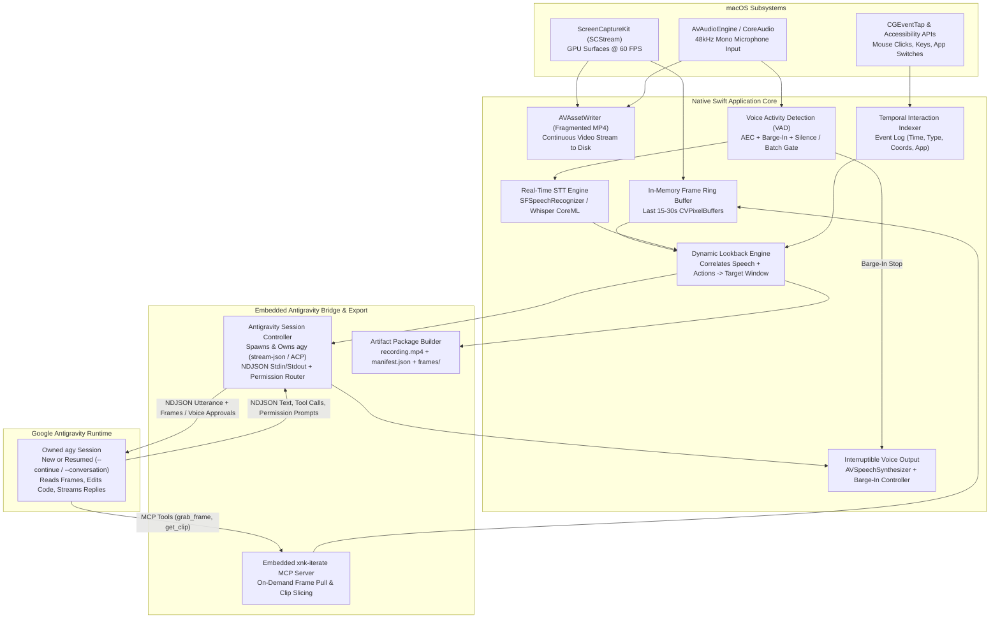

# System Architecture (`xnk-iterate`)

This document outlines the architectural design of `xnk-iterate`, detailing how native macOS frameworks, real-time audio/video processing, temporal indexing, and AI agent integration work together.

---

## 1. High-Level Architecture Diagram



---

## 2. Subsystem Breakdown

### 2.1 Video Capture Subsystem (`ScreenCaptureKit`)
* **Technology:** Apple's `ScreenCaptureKit` (`SCStream`, `SCStreamOutput`), introduced in macOS 12.3.
* **Characteristics:**
  * Captures directly from Apple Silicon Metal GPU surfaces (`IOSurface`).
  * Near-zero CPU overhead; battery friendly.
  * Native Retina resolution scaling or configurable 1080p / native mode.
* **Target Filtering:**
  * `SCContentFilter`: Configured for single-window capture (e.g. Simulator, Xcode, Chrome window) or whole displays.
  * Self-Exclusion: The recorder's own HUD and window are explicitly added to `filter.excludedWindows`.
* **Streaming Storage:**
  * Managed by `AVAssetWriter` configured for **Fragmented MP4 (`fMP4`)** output.
  * Avoids corrupt files if interrupted or terminated unexpectedly.
  * Allows reading or streaming active video chunks without closing the file.

### 2.2 In-Memory Video Frame Ring Buffer
* In parallel with writing to disk, `SCStreamOutput` delivers `CMSampleBuffer` frames.
* The application maintains a lightweight circular ring buffer of the last 15–30 seconds of `CVPixelBuffer` frames (or downsampled keyframe thumbnails at 2–5 FPS).
* **Instant Snapshot Extraction:**
  * When speech silence marks the end of a comment, snapshot frames can be grabbed **directly from memory in < 15 milliseconds** rather than waiting for `ffmpeg` or disk seeks.

### 2.3 Audio & Speech-to-Text Pipeline
* **Input:** `AVAudioEngine` tapping the default system input microphone.
* **Voice Activity Detection (VAD):**
  * CoreAudio RMS level meter combined with energy thresholding (or lightweight Silero VAD CoreML model).
  * Emits `speech_start` when volume/speech exceeds threshold for > 200ms.
  * Emits `speech_end` when silence persists for > 400ms.
* **Streaming Transcription:**
  * Primary: Apple `SFSpeechRecognizer` (`SFSpeechAudioBufferRecognitionRequest`).
    * Zero extra bundle size; on-device Apple offline speech models.
    * Emits partial tokens with accurate word-level timecodes.
  * Secondary (Optional): Local `whisper.cpp` / Whisper CoreML running on the Apple Neural Engine (ANE).

### 2.4 Interaction Logging (`CGEventTap`)
* Uses a passive macOS `CGEventTap` (`kCGEventTapOptionListenOnly`) to log user interactions during the recording:
  * Mouse Down / Click: Timestamp $t_{\text{action}}$, $(x, y)$ coordinates, click count.
  * Keyboard Shortcuts: Modifiers (`⌘`, `⌥`, `⇧`) and key codes.
  * Active App Changes: `NSWorkspace.didActivateApplicationNotification` captures application bundle ID and focused window title.
* Events are stored in a rolling timeline array alongside video timestamps.

---

## 3. The Dynamic Lookback Engine

The core design principle of director-mode feedback: **comments are latent**. Humans speak *after* seeing something happen.

```text
Time Line:
---|----------------------|-----------------------|-----------------------|--->
  t_action               t_speech_start          t_speech_mid            t_speech_end
  (Clicked Button)       ("Hey, this button...")  ("...did not submit...") (Silence)
  
  [<---------------------- DYNAMIC LOOKBACK WINDOW --------------------->]
```

### Calculation Rules

```swift
func calculateLookback(speechStart: TimeInterval, speechEnd: TimeInterval) -> LookbackWindow {
    let utteranceDuration = speechEnd - speechStart
    
    // 1. Identify preceding interactions within a reasonable threshold (e.g. 10s prior to speech)
    let candidateActions = interactionTimeline.filter { 
        $0.timestamp >= (speechStart - 10.0) && $0.timestamp <= speechStart 
    }
    
    let anchorAction = candidateActions.last // e.g. the most recent click or keystroke
    
    let windowStart: TimeInterval
    if let action = anchorAction {
        // Anchor 1.0s before the action that provoked the commentary
        windowStart = max(0, action.timestamp - 1.0)
    } else {
        // Fallback: Utterance length + proportional buffer
        let buffer = max(3.5, utteranceDuration * 0.25)
        windowStart = max(0, speechStart - buffer)
    }
    
    return LookbackWindow(
        startTime: windowStart,
        endTime: speechEnd,
        triggerTimestamp: anchorAction?.timestamp ?? (speechStart - 3.5),
        reactionTimestamp: speechEnd,
        anchorAction: anchorAction
    )
}
```

### Frame Extraction Strategy
* **Short comment (< 10 seconds):**
  * Extract **Trigger Frame** at $t_{\text{trigger}}$ (when the UI event happened).
  * Extract **Reaction Frame** at $t_{\text{reaction}}$ (when speech completed).
* **Extended comment (> 15 seconds):**
  * Extract a 4-to-6 frame carousel evenly distributed between $t_{\text{start}}$ and $t_{\text{end}}$.
  * Optionally slice a lightweight sub-clip (`.mp4`) of the specific lookback interval.

---

## 4. Embedded Google Antigravity Live Session Pipeline

`xnk-iterate` **spawns, owns, and directly orchestrates** a live Google Antigravity session — embedding a full two-way conversational voice + screen vision loop (modeled after Antigravity's `/voice live`) inside the native macOS capture app.

### Mode 1: Owned `agy` Live Session (Primary)
When a director session starts, `AntigravitySessionController` launches an `agy` child process scoped to the user's selected workspace:

```bash
agy --print \
  --input-format stream-json \
  --output-format stream-json \
  [--continue | --conversation <id>] \
  --settings /path/to/xnk-session-settings.json
```
*(Or `agy acp` / Python SDK where bidirectional tool-permission control is required; see `SPECIFICATION.md`.)*

1. **Auto-Stream with Batch-Hold Hotkey:**
   - **Default (Auto-Stream):** After ~400–500ms of silence, `DynamicLookbackEngine` extracts the Trigger and Reaction PNG frames and immediately writes a structured NDJSON turn to `agy`'s stdin containing the transcript, lookback timecodes, `CGEventTap` interaction context, and frame file paths.
   - **Batch-Hold Mode:** Pressing/holding the Batch hotkey pauses auto-dispatch and buffers consecutive utterances + frames into a single combined multimodal turn, dispatched cleanly when released or confirmed.

2. **Full Two-Way Conversational Voice (Barge-In & Voice Approvals):**
   - **Acoustic Echo Cancellation (AEC):** `AVAudioEngine` enables Voice Processing I/O (`inputNode.setVoiceProcessingEnabled(true)`) so the agent's spoken voice does not re-trigger microphone VAD/STT.
   - **Interruptible Speech (Barge-In):** As `agy` streams assistant response tokens over NDJSON stdout, sentence chunks are spoken aloud via `AVSpeechSynthesizer` (or optional local neural TTS). The moment VAD detects user speech (`> 200ms`), TTS playback stops immediately (`stopSpeaking(at: .immediate)`) so you can interrupt and steer mid-sentence.
   - **Voice Permission Approvals:** When `agy` requests approval for a tool execution (e.g., running a shell command or editing a file), `xnk-iterate` surfaces an inline approval banner on the HUD, speaks a concise summary ("Approve running `swift test`?"), and intercepts voice intent (**"yes" / "approve" / "go ahead"** vs. **"no" / "deny" / "stop"**) or keyboard shortcuts to reply directly to `agy`.

3. **On-Demand Vision Tools (Embedded MCP Server):**
   - `xnk-iterate` registers a lightweight local MCP server with the spawned `agy` session so the agent can pull extra frames (`xnk_grab_frame`) or slice a short sub-clip (`xnk_get_clip`) from the rolling buffer / `fMP4` stream whenever it needs more visual context.

### Mode 2: Static Bundle Export (Post-Session)
* Regardless of live streaming, stopping a recording always seals a self-contained bundle on disk:
  ```text
  storage/recordings/capture_<id>_<timestamp>/
  ├── recording.mp4
  ├── manifest.json
  ├── frames/
  │   ├── frame_01_trigger_4.2s.png
  │   ├── frame_01_reaction_8.5s.png
  │   └── ...
  └── analysis.md  (Optional pre-compiled summary)
  ```
